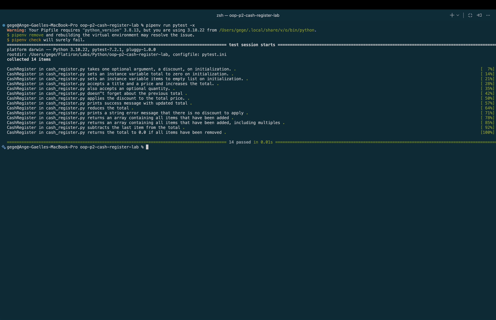

# Object Oriented Programming (OOP) Part 2 - Cash Register Lab

Now that we’ve discussed more about object oriented design philosophies and techniques like decorators we will be looking at building more complex objects. In this case we will be building a cash register object to simulate different functions of a cash register for an e-commerce site. 

## Tools & Resources
* [GitHub Repo](https://github.com/learn-co-curriculum/oop-p2-cash-register-lab)
* [Python Classes](https://docs.python.org/3/tutorial/classes.html)

## Instructions

### Set Up

Before we begin coding, let's complete the initial setup for this lesson: 
* Fork and Clone: For this lesson, you will need the following GitHub Repo:
  * Go to the provided GitHub repository link.
  * Fork the repository to your GitHub account.
  * Clone the forked repository to your local machine.
* Open and Run File
  * Open the project in VSCode.
  * Run npm install to install all necessary dependencies.

### Task 1: Define the Problem

Build a model for a cash register
* Build a cash register object
* Add items
* Apply discounts
* Void previous transactions

### Task 2: Determine the Design

Cash Register
* Attributes
  * discount
  * total
  * items
  * previous_transactions
* Methods
  * add_item(item, price, quantity)
  * apply_discount()
  * void_last_transaction()

### Task 3: Develop, Test, and Refine the Code

#### Step 1: Git Feature Branch

* Create a feature branch for your work using git.

#### Step 2: Create a CashRegister class

* ```__init__```:
  * discount
  * Allow for user to input
  * If no input initialize as 0
  * Note that discount is a percentage off of the total cash register price (e.g. a discount of 20 means the customer receives 20% off of their total price)
* ```total```
  * Initialize as 0
* ```items```
  * Initialize as empty array
* ```previous_transactions```
  * Initialize as empty array

#### Step 3: Properties

* Discount:
  * Ensure discount is an integer
  * Ensure that discount is between 0-100 inclusive
  * If not print “Not valid discount”

#### Step 4: Methods

* add_item(item, price, quantity)
  * Add price to total
  * Add item to the items array
  * Add an object to the previous transactions with the item, price and quantity.
* apply_discount()
  * Apply discount as percentage off from total
  * Remove the last item of previous_transaction from array
    * Ensure price reflects correctly
    * Ensure items reflects correctly
  * If no transactions in array print “There is no discount to apply.”
* void_last_transaction()
  * Remove the last item of previous_transaction from the array.
    * Ensure the price reflects correctly.
    * Ensure items reflect correctly.
  * If no transactions are in the array, print “There is no transaction to void.”

#### Step 5: Push feature branch and open a PR on GitHub

* Save, commit, and push your code to GitHub.
* Open a PR on the main branch of your own repo (be sure not to open a PR on the learn-co-curriculum repo).

#### Step 6: Merge to main

* Review the PR and merge your finished code into the main branch.

### Task 4: Document and Maintain

Best Practice documentation steps:

* Add comments to code to explain purpose and logic
  * Clarify intent / functionality of code to other developers
  * Add screenshot of completed work included in Markdown in README.
  * Update README text to reflect the functionality of the application following https://makeareadme.com. 
* Delete any stale branches on GitHub
* Remove unnecessary/commented out code
* If needed, update git ignore to remove sensitive data

## Save your work and push to GitHub

Before you submit your solution, you need to save your progress with git.
1. Add your changes to the staging area by executing git add .
2. Create a commit by executing git commit -m "Your commit message"
3. Push your commits to GitHub by executing git push origin main or git push origin master , depending on the name of your branch (use git branch to check on which branch you are).

## Submission and Grading Criteria

1. Use the rubric in Canvas as a guide for how this lab is graded.
2. Your submission will be automatically scored in CodeGrade, using the most recent commit. Remember to make sure you have pushed your commit to GitHub before submitting your assignment. 
3. You can review your submission in CodeGrade and see your final score in your Canvas gradebook.
4. When you are ready to submit, click the ***Load Lab: Object Oriented Programming (OOP)- Part 2- Cash Register*** button in Canvas to launch CodeGrade.
  * Click on + Create Submission. Connect your repository for this lab.
  * For additional information on submitting assignments in CodeGrade: [Getting Started in Canvas](https://help.codegrade.com/for-students/getting-started/getting-started-in-canvas).

---

## My Completed Cash Register Project

### Project Overview

For this lab, I created a `CashRegister` class using Python and Object-Oriented Programming (OOP).

The cash register can add items, calculate totals, apply discounts, and void previous transactions.

### Python Concepts I Practiced

- **Classes and objects:** Created a `CashRegister` class.
- **Instance attributes:** Used `total`, `discount`, `items`, and `previous_transactions` to store information.
- **Methods:** Created functions inside the class to perform cash register operations.
- **Properties:** Used `@property` and `@discount.setter` to validate discounts.
- **Loops:** Used a `for` loop to handle multiple quantities of an item.
- **Conditional statements:** Used `if` and `else` to handle discounts.

### Cash Register Methods

**`__init__(discount=0)`**

Creates a new cash register with a starting total of 0, a default discount of 0%, and empty lists for items and transactions.

**`add_item(name, price, quantity=1)`**

Adds an item to the cash register. If the quantity is greater than 1, the total price is calculated by multiplying the price by the quantity.

**`apply_discount()`**

Checks whether a discount is available. If there is a discount, it calculates the percentage off and updates the total. If the discount is 0%, it prints a message.

**`void_last_transaction()`**

Removes the last transaction from the transaction history and subtracts its cost from the total.

**`discount` property**

Uses a getter and setter to manage the discount percentage and check that it is an integer between 0 and 100.

### How to Run the Project

1. Clone the Repository

git clone git@github.com:a-gbatie/oop-p2-cash-register-lab.git

2. Open the Project

Open the cloned project folder in Visual Studio Code.

3. Install Dependencies

This project uses Python and Pipenv.

python3 -m pipenv install

4. Run the Tests

python3 -m pipenv run pytest

To stop at the first failing test:

python3 -m pipenv run pytest -x

### Testing

I used Pytest to test the functionality of my CashRegister class.

The tests cover:

- Creating a cash register.
- Initializing attributes.
- Adding items and updating totals.
- Adding items with optional quantities.
- Applying discounts.
- Displaying discount messages.
- Voiding transactions.
- Handling multiple items in a transaction.

### Screenshot of Completed Work

The screenshot below shows the results of running the project's tests.

